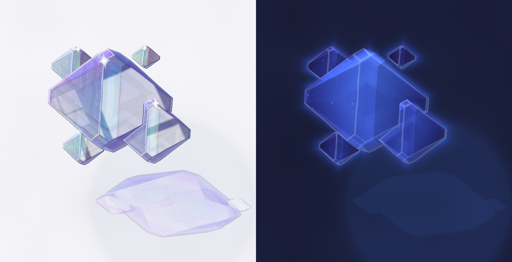

# UniAether

**Crystals computed from mineralogy and optics.** 中文说明见 [README.zh-CN.md](README.zh-CN.md).



> “By aesthetic, I mean responsive to the pattern which connects.”
> Gregory Bateson, *Mind and Nature: A Necessary Unity* (1979)

UniAether draws mineral crystals live in the browser. Each crystal is a set of faces taken from mineralogy. Each pixel follows light through the stone:

- refraction at every face
- colour absorbed by thickness
- growth zones and phantoms
- pleochroism, dispersion, labradorescence and asterism
- fluorescence under a long-wave UV lamp
- the coloured projection the stone casts on the ground

Nothing in it is generated. Every frame is computed.

It grew out of *Ore Projection*, the aesthetic system Helen AphroIcy made for her original character Fufu, the mineral game [ISARO](https://isaro.aphrogenes.com) and the Crystal Atlas. It ships with 26 minerals and 227 colours, every colour sourced.

## What you can do with it

- **Show a mineral:** one HTML tag, turnable with a finger or the mouse.
- **Light it:** daylight, long-wave UV or lamplight; alexandrite turns red under the lamp.
- **Grade it:** D (rough) to S (museum grade). Lower grades are frostier, stained and duller; S glints.
- **Put it on paper, or on nothing:** on paper it casts its coloured projection; with `transparent: true` it drops onto any page or game scene.
- **Invent your own crystal:** any shape, colour, glow, iridescence or fire. The optics stay true.
- **Take it into a game:** export a turning sprite sheet with a JSON atlas, or use the live canvas as a texture in PixiJS, Phaser or Three.js.

Try everything in the [playground](playground/index.html).

## Quick start

```html
<script src="dist/uniaether.js"></script>

<uni-aether mineral="fluorite" colour="emerald" grade="S"></uni-aether>
<uni-aether mineral="corundum" light="uv"></uni-aether>
<uni-aether mineral="labradorite" sphere></uni-aether>
```

Or from JavaScript:

```js
import UniAether from './dist/uniaether.mjs';

const stone = UniAether.create('#stage', { mineral: 'beryl', colour: 'aqua', grade: 'A' });
stone.set({ light: 'uv' });          // change anything later
stone.turn(.8, .1);                  // yaw, pitch (radians)
const png = stone.snapshot({ crop: 'square', size: 512 });
```

To see every mineral and colour, use `UniAether.minerals()`. For the sources behind them, use `UniAether.sources('beryl')`.

### Options

| option | values | default |
|---|---|---|
| `mineral` | one of the 26 ids: `fluorite`, `spinel`, `garnet`, `diamond`, `tourmaline`, `corundum`, `quartz`, `beryl`, `apatite`, `topaz`, `chrysoberyl`, `zoisite`, `peridot`, `cordierite`, `zircon`, `wulfenite`, `apophyllite`, `tugtupite`, `spodumene`, `titanite`, `moonstone`, `euclase`, `kyanite`, `labradorite`, `amazonite`, `rhodonite` | `fluorite` |
| `colour` | a colour id such as `emerald`, or an index | the first colour |
| `form` | which cluster of that colour's habit, by index | `0` |
| `grade` | `D` `C` `B` `A` `S`, or none (as on the colour cards) | none |
| `light` | `day`, `uv`, `lamp`; UV only glows where fluorescence is on record | `day` |
| `projection` | show the coloured projection on the ground | `true` |
| `sphere` | show the mineral as a polished sphere: same colours, zones and play of light | `false` |
| `crystal` | your own crystal, see below; replaces `mineral` | — |
| `transparent` | transparent background, for compositing | `false` |
| `interactive` | turn with mouse or finger | `true` |
| `autoplay` | animate by itself; `false` means you call `render()` | `true` |
| `quality` | render scale (1 = 880 × 1040); leave empty to let it adapt | auto |
| `sound` | the faint chime when a crystal finishes growing | `false` |

The instance has these methods:

- `set(options)`
- `turn(yaw, pitch)`
- `spin(speed)`
- `grow()`: replays the growth
- `pose({ yaw, pitch, t })`: freezes a frame
- `render()`
- `snapshot({ crop: 'frame' | 'square', size })`
- `on('change' | 'lost' | 'unsupported', fn)`
- `destroy()`

## Make your own crystal

Shapes can be invented; the optics stay true.

```js
UniAether.create('#stage', {
  crystal: {
    name: 'Aether shard',
    forms: [                                   // up to 5 crystals, 18 faces each
      { shape: 'prism', n: 6, size: 1.25, params: { length: 1.3, width: .42, tip: .7 } },
      { shape: 'bipyramid', n: 9, size: .5, at: [-.9, -.6, .3] },
      { faces: [[0, 1, 0, .6], [0, -1, 0, .6], /* … */], size: .5, at: [.9, -.5, .5] },
    ],
    colour: '#7b6cff', colour2: '#5fe6ff', zone: 'rim',   // zones: even, heart, core, rim, band, melon
    ior: 1.75, dispersion: 1.8, lustre: 1.25,
    glow: '#5fe6ff', glowStrength: .4,                     // an inner light
    iridescence: .5, iridescenceHue: .6,                   // a labradorite-like play of colour
    fluorescence: '#5fe6ff',                               // its colour under the UV lamp
  },
});
```

**Ready-made shapes** (`UniAether.shapes`):

- cubic: `cube`, `octahedron`, `dodecahedron`, `cuboctahedron`, `spinelTwin`
- other habits: `quartz`, `beryl`, `tourmaline`, `apatite`, `zircon`, `topaz`, `barrel`, `blade`, `tabular`, `block`
- with parameters: `prism(n, { length, width, tip, flat })` and `bipyramid(n, { width, tip })`
- `sphere`: a smooth ball

A face is `[nx, ny, nz, d]`: a unit normal and its distance from the centre.

## Polished spheres

Mineral spheres are their own collecting tradition. Any mineral can be shown as one: `sphere: true` keeps its colours, growth zones, labradorescence and asterism.

```js
UniAether.create('#stage', { mineral: 'labradorite', sphere: true, grade: 'S' });
```

## In games

**Sprite sheets work in any engine.** They turn the stone once and come with a TexturePacker JSON Hash atlas:

- PixiJS and Phaser read the atlas as is.
- Unity, Godot and GameMaker have importers for it.

```js
const sheet = await UniAether.sprites({ mineral: 'spinel', grade: 'S', frames: 36, size: 256, background: 'none' });
// sheet.canvas, sheet.json, await sheet.png()
```

The playground has a button that does this for you.

**Live textures** are for one or two hero stones:

```js
const live = UniAether.texture({ mineral: 'quartz', colour: 'amethyst', transparent: true });
// PixiJS:   const tex = PIXI.Texture.from(live.canvas); app.ticker.add(() => tex.source.update());
// Three.js: const tex = new THREE.CanvasTexture(live.canvas); every frame: tex.needsUpdate = true;
```

See [examples/pixi.html](examples/pixi.html), [examples/three.html](examples/three.html) and [examples/basic.html](examples/basic.html).

## How it works

UniAether has five layers. Everything except the data is about 730 (long) lines of plain JavaScript and GLSL, with no dependencies.

1. **Data.** Minerals carry their crystal system, refractive index, dispersion and optical character. Colours carry how they look, how they are layered, how rare they are and whether they glow.
2. **Geometry.** A crystal is the space inside its faces: cube {100}, octahedron {111}, dodecahedron {110}, prisms and pyramids for the other systems. Twins follow real twin laws.
3. **Optics.** One fragment shader casts a ray per pixel:
   - Snell refraction in and out, with total internal reflection.
   - Beer–Lambert absorption along the path.
   - Zoning, pleochroism by direction, and dispersion along the edges.
   - Faces mirror a painted environment, so a whole face changes colour as the stone turns.
   - The ground picks up the light that passed through.
   - Pigment grain and edge pooling give the watercolour and mineral-pigment texture.
4. **Interaction.** Dragging with inertia, growth, star glints that land on the vertices facing the light.
5. **Output.** Canvas, snapshots, sprite sheets, textures.

## Limits

- It needs WebGL2, which nearly every current browser has.
- Each crystal is convex, with up to 18 faces, or a sphere; a cluster holds up to 5.
- Phones lower the render scale on their own when frames get slow.

## Credit, licence, citation

- **Code:** MIT ([LICENSE](LICENSE)). Use it for anything, including commercial work, and keep the notice.
- **Mineral data** (`src/data/`: the 26 looks, the 227 colours with their layering, rarity and notes, and the source list): CC BY-NC 4.0 ([LICENSE-DATA.md](LICENSE-DATA.md)).
  - Free for non-commercial work, with credit.
  - For commercial use, either write to Helen AphroIcy through [aphrogenes.com](https://aphrogenes.com), or make your own crystals with `UniAether.crystal()`.
- **Names:** UniAether, ISARO, Fufu and their marks are not licensed ([NOTICE](NOTICE)).

**Please credit it like this**, wherever your work lists its tools:

```
Crystals rendered with UniAether by Helen AphroIcy · aphrogenes.com
```

For research, publications and portfolios, cite it with [CITATION.cff](CITATION.cff); GitHub shows a “Cite this repository” button.

## Show what you made

UniAether is also a way of watching where these crystals go and what people make of them.

- Post your work in [Discussions → Show and tell](../../discussions/categories/show-and-tell).
- Add the topic `uniaether` to your repository.
- If you like, add the badge [](https://aphrogenes.com).

The library sends nothing anywhere. No analytics, no calls home.

## How it was made

Helen AphroIcy made the concept, the aesthetics, the framework and the layout. She chose every colour from colour cards and real mineral photographs she collected. The code took shape through long conversations with AI, which here is part of the medium: *me, Fufu, and the medium between us*.
