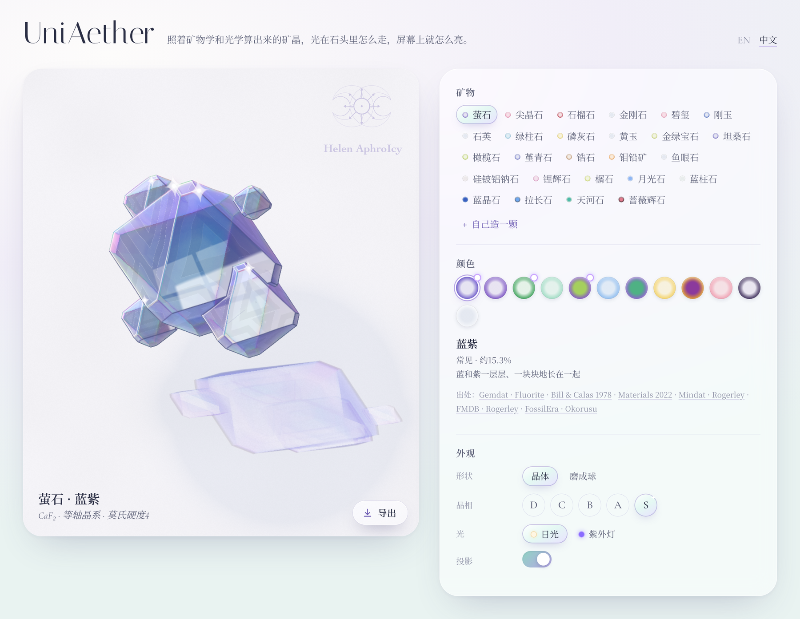

# UniAether

**按矿物学和光学算出来的矿晶，直接在浏览器里画。** English: [README.md](README.md).



> “By aesthetic, I mean responsive to the pattern which connects.”
>「我说的美学，是对那连接一切的模式有所回应。」Gregory Bateson，《心灵与自然》（1979）

每一颗晶体都由真实的晶面组成，每个像素都跟着光穿过石头：折射、越厚颜色越深、生长色带、多色性、色散、紫外灯下的荧光，还有落在纸上的彩色投影。没有一样是生成的，每一帧都是算出来的。

里面有26种矿物、227种颜色，每种颜色都核对过出处。它来自「矿石投影」，是Helen AphroIcy为她的原创角色浮浮、矿物游戏[ISARO](https://isaro.aphrogenes.com)和矿晶集做的矿晶美学系统。

## 试一试

打开[试玩页](https://helenaphroicy.github.io/UniAether/playground/)：挑矿物和颜色，换品相、换光，用手指或鼠标转，还能导出。

## 开始用

```html
<script src="dist/uniaether.js"></script>

<uni-aether mineral="fluorite" colour="emerald" grade="S"></uni-aether>
<uni-aether mineral="corundum" light="uv"></uni-aether>
<uni-aether mineral="labradorite" sphere></uni-aether>
```

也可以用JavaScript：

```js
import UniAether from './dist/uniaether.mjs';

const stone = UniAether.create('#stage', { mineral: 'beryl', colour: 'aqua', grade: 'A' });
stone.set({ light: 'uv' });
```

最常用的几个设置：

- `mineral`和`colour`：矿物和颜色，`UniAether.minerals()`能列出全部
- `grade`：品相，从`D`（矿料）到`S`（博物馆级）
- `light`：`day`日光、`uv`紫外灯、`lamp`白炽灯
- `sphere: true`：同一种矿物磨成球
- `transparent: true`：透明底，方便叠在别的画面上

全部设置、自己造晶体的写法，见[英文说明](README.md)。

## 放进游戏

```js
const sheet = await UniAether.sprites({ mineral: 'spinel', grade: 'S', frames: 36, size: 256 });   // 转一圈的精灵图 + JSON
const live = UniAether.texture({ mineral: 'quartz', transparent: true });                         // 实时贴图
```

PixiJS、Phaser可以直接读精灵图，Unity、Godot、GameMaker有导入插件。例子：[PixiJS](examples/pixi.html)、[Three.js](examples/three.html)、[普通网页](examples/basic.html)。

## 怎么做出来的

大约700行JavaScript和GLSL，不依赖任何库，加上矿物数据。

```
src/data              矿物、颜色、出处
src/core/colour.js    颜色 → 每个通道的吸收、生长色带、荧光
src/core/forms.js     晶形 → 晶面、双晶、晶簇
src/api.js            你的设置 → 一块石头
src/core/renderer.js  WebGL2、拖动、生长、星闪
src/core/shader.js    每个像素一条光线
```

1. **颜色**：每种颜色换算成红、绿、蓝各自的吸收系数，所以石头厚的地方深、薄的边上浅（比尔–朗伯定律）。
2. **形状**：一颗晶体就是一组晶面围起来的空间，比如立方体{100}、八面体{111}；一颗最多18个面，一簇最多5颗。
3. **光**：每个像素一条光线，进入晶体时折射（斯涅尔定律），该反射时在里面反射，一路经过的色带决定它的颜色。
4. **投影**：从纸上往灯的方向反着追，穿过晶体，就得到落在纸上的彩色投影。
5. **质感**：颜料颗粒和柔和的描边，是水彩和矿物颜料的感觉；品相再加上雾、污渍和幻影。

## 限制

- 需要WebGL2，现在的浏览器几乎都有。
- 晶体是立体的，最多18个面（或者是一个球），一簇最多5颗。

## 许可和署名

- **代码**：MIT。
- **矿物数据**（`src/data/`）：CC BY-NC 4.0。非商用免费，署名就行；想商用，请通过[aphrogenes.com](https://aphrogenes.com)联系，或者用`UniAether.crystal()`自己造晶体。
- **名字和标志**：UniAether、ISARO、浮浮（浮溟）这些名字和标志不在许可里。

请这样署名：

```
矿晶渲染：UniAether · Helen AphroIcy
Crystals rendered with UniAether by Helen AphroIcy · aphrogenes.com
```

引用请用[CITATION.cff](CITATION.cff)。库本身不收集、也不往外发任何数据。
