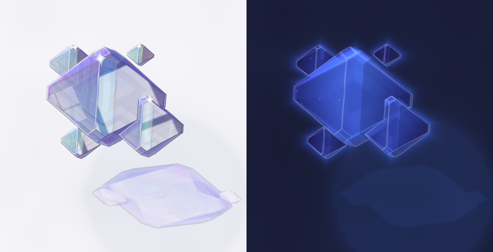

# UniAether

**按矿物学和光学算出来的矿晶。** English: [README.md](README.md).



> “By aesthetic, I mean responsive to the pattern which connects.”
> 「我说的美学，是对那连接一切的模式有所回应。」Gregory Bateson，《心灵与自然》（1979）

UniAether 在浏览器里实时画矿晶。

每一颗晶体都是矿物学里的一组晶面。屏幕上每个像素都跟着光穿过石头：

- 每个面都折射
- 越厚的地方颜色吸收得越多
- 生长色带和幻影
- 多色性、色散、晕彩、星光
- 长波紫外灯下的荧光
- 石头落在地上的彩色投影

这里没有一样东西是"生成"的，每一帧都是算出来的。

它来自「矿石投影」，是 Helen AphroIcy 为她的原创角色浮浮、矿物游戏 [ISARO](https://isaro.aphrogenes.com) 和矿晶集做的那套矿晶美学系统。里面带着 26 种矿物、227 种颜色，每种颜色都有出处。

## 能做什么

- **摆一颗矿物出来：** 一个标签就行，手指或鼠标都能转。
- **换灯：** 有日光、长波紫外灯和白炽灯三种。变石在白炽灯下会从绿变红。
- **定品相：** 从 D（矿料）到 S（博物馆级）。品相越低越雾、越脏、越暗；S 级会闪。
- **放在纸上，或者什么都不垫：** 放在纸上会落下彩色的投影；`transparent: true` 是透明底，可以直接放进网页或游戏场景。
- **自己造一块：** 形状、颜色、内光、晕彩、火彩都能定。形状可以是虚构的，光学照真的算。
- **磨圆的矿石球：** 矿石球本来就是收藏里的一大类。任何矿物都能换成一颗磨圆的球（`sphere: true`），颜色、色带、晕彩、星光都保留。
- **带进游戏：** 可以导出转一圈的精灵图，附一份 JSON 图集；也可以把实时画面当成 PixiJS、Phaser、Three.js 里的贴图。

全部功能都可以在[试玩页](playground/index.html)里试。

## 开始用

```html
<script src="dist/uniaether.js"></script>

<uni-aether mineral="fluorite" colour="emerald" grade="S"></uni-aether>
<uni-aether mineral="corundum" light="uv"></uni-aether>
<uni-aether mineral="labradorite" sphere></uni-aether>
```

也可以用 JavaScript：

```js
import UniAether from './dist/uniaether.mjs';

const stone = UniAether.create('#stage', { mineral: 'beryl', colour: 'aqua', grade: 'A' });
stone.set({ light: 'uv' });          // 之后随时改
stone.turn(.8, .1);                  // 转多少（弧度）：左右、上下
const png = stone.snapshot({ crop: 'square', size: 512 });
```

- `UniAether.minerals()` 列出所有矿物和颜色。
- `UniAether.sources('beryl')` 列出某种矿物的出处。

参数、自己造晶体的写法、游戏里的用法，都写在英文说明里，那边的表和例子更全。

## 署名、许可、引用

- **代码**：MIT。商用也可以，保留版权声明就行。
- **矿物数据**：指 `src/data/` 里的东西，包括 26 种矿物的样子、227 种颜色和它们的分层、稀有度、说明和出处。数据用 CC BY-NC 4.0：
  - 非商用免费，署名就行。
  - 想商用，请通过 [aphrogenes.com](https://aphrogenes.com) 联系 Helen AphroIcy；或者用 `UniAether.crystal()` 自己造晶体，那样不受这条限制。
- **名字和标志**：UniAether、ISARO、浮浮这些名字和它们的标志都不在许可里。

**请这样署名**，写在作品列工具的地方，比如作品说明、片尾或网页页脚：

```
矿晶渲染：UniAether · Helen AphroIcy
Crystals rendered with UniAether by Helen AphroIcy · aphrogenes.com
```

论文、作品集、申请材料里要引用时，用 [CITATION.cff](CITATION.cff)。GitHub 页面上会有「Cite this repository」按钮。

## 给我们看看你做了什么

UniAether 也是一种观察：看这些矿晶走到了哪里，被做成了什么。

- 发到 [Discussions → Show and tell](../../discussions/categories/show-and-tell)。
- 给你的仓库打上 `uniaether` 标签。
- 想的话也可以挂上徽章：[](https://aphrogenes.com)。

库本身不往外发任何东西：没有统计，不回传。

## 怎么做出来的

概念、美学、框架和版式由 Helen AphroIcy 设计。每一种颜色都是她从色卡和自己收集的真实矿物照片里挑的。

代码是在和 AI 的很多轮对话里成形的。在这里，AI 是媒介的一部分：*me, Fufu, and the medium between us*。
